  

---

## Featured project — E-commerce Sales Analysis

**[Explore the repository](https://github.com/Lifewitdata/ecommerce-sales-analysis)** · **[Live Tableau dashboard](https://public.tableau.com/app/profile/isfaque.ansari5273/viz/Ecommerce_Sales_Executive_Overview/E-commerceSales-ExecutiveOverview)** · **[Excel workbook](https://github.com/Lifewitdata/ecommerce-sales-analysis/blob/main/excel/Ecommerce_Sales_Excel_Report.xlsx)**

Python + MySQL analysis of **2,000 synthetic retail orders** across **573 customers**, delivered as a Tableau Public executive dashboard and an eight-sheet Excel report. **Sales Rs 3,59,28,969 · Profit Rs 51,82,912 · Margin 14.43%.**

Electronics brings 71.74% of revenue at an 8.93% margin; discounts above 20% lose Rs 2.49 lakh. Includes the packaged Tableau workbook and **127 SQL checks** that reconcile MySQL queries with pandas.

---

## 👋 Hello

I'm **Isfaque Ansari** — a data analyst and scientist working the full path from raw event tables to a decision someone can defend. Two years of that inside a live product at Weblays Technologies, and now a portfolio where I pick the hard methods on purpose: staggered difference-in-differences, position-bias-corrected ranking, uplift on a real randomized campaign.

I care about the boring parts — schema tests, sample-ratio checks, honest confidence intervals — because that is what makes the interesting parts true.

`Python` · `R` · `SQL` · `Tableau` · `Experiment Design` · `Causal Inference`

---

## 🏅 Track record & certifications

**Data Analyst · Weblays Technologies, New Delhi · Sep 2023 – Nov 2025**

- Cut reporting errors by **~30%** and manual re-checks by **~40%** by rebuilding the reporting layer around validated sources instead of spreadsheets.
- Consolidated **10+ raw sources** covering **4.2K–5.6K WAU** into one consistent metric definition across product and finance.
- Shipped **20+ analyses and hypothesis tests per quarter** in Tableau — funnels, cohorts and 5+ behavioural segments.
- Traced an unexplained **33% WAU spike** to a logging bug in **2 days**, before it reached an investor deck.

**Independent Data Analyst · Portfolio & upskilling · Nov 2025 – present**

- **7+ end-to-end published projects** with reproducible data generation, tests and written decision memos.

**Certifications**

- **SQL** — University of Colorado Boulder, Coursera · scored **92.26%**
- **Python and Statistics** — HKUST · scored **95%**
- **Google Data Analytics** — Coursera
- **Citi job simulation** — Forage

B.Tech, Mechanical Engineering · Abacus Institute of Engineering & Management · 2015–2019 · CGPA 7.58/10. I came to data through manufacturing process analysis, which is why I still start every dataset by asking how it was measured.

---

## 🧪 Selected work

**And three that are worth opening:**

- [**🎮 Social gaming activation funnel**](https://github.com/Lifewitdata/social-gaming-activation-analysis) — `PostgreSQL` · `SQL` · `Tableau` 
  10,000 users · 281,652 events. Activation **45.29%** (4,482 of 9,897), with lobby→game loss split into never-attempted vs attempt-failed, and an 18.77% vs 2.68% matchmaking failure gap on low tiers. Ships 3 dashboards and a non-technical decision memo.

- [**⚙️ Churn + CLV on PySpark**](https://github.com/Lifewitdata/customer-churn-pyspark-mlops) — `PySpark` · `FastAPI` · `Docker` · `pytest` 
  Bronze→Silver→Gold lakehouse with a Spark SQL warehouse, dual gradient-boosted models (churn + lifetime value), a versioned model registry, drift monitoring, and a containerised scoring service under CI.

- [**🎬 Media recommendation engine**](https://github.com/Lifewitdata/media-recommendation-engine) — `scikit-learn` · `NMF` · `TF-IDF` · `hybrid ranking` 
  175,540 events across 5,000 users and 1,500 titles — collaborative filtering, matrix factorization and a cold-start-aware hybrid ranker, evaluated on Precision@10, Recall@10, AUC and lift rather than accuracy alone.

> 📚 **140+ public repositories** — <a href="https://github.com/Lifewitdata?tab=repositories">browse them all →</a>

---

## 🛠️ Toolkit

Everything below is traceable to a repo on this account or to the work I did at Weblays — it is the list I have shipped with, not the list I would like to have.

**Languages & analysis**

**Databases & pipelines**

**Serving & tooling**

- **SQL** — CTEs, window functions, segmentation. BigQuery, PostgreSQL, MySQL, SQLite.
- **Python** — pandas, NumPy, SciPy, scikit-learn, Polars.
- **Experimentation** — A/B design, power & MDE, SRM checks, z-tests, chi-square, Mann-Whitney U, ANOVA, guardrails.
- **Causal inference** — Staggered difference-in-differences, synthetic control, uplift and segment lift.
- **Machine learning** — Recommenders (CF, NMF, TF-IDF, hybrid, cold-start), logistic regression, random forest, KMeans, gradient boosting, leakage-safe features, Precision@k / Recall@k / AUC.
- **Analytics engineering** — dbt, DuckDB, PySpark medallion modelling, schema tests, reproducible pipelines.
- **BI & delivery** — Tableau, Streamlit, Plotly, FastAPI services, Docker, Excel.
- **LLM tooling** — Hugging Face transformers, LangChain, FAISS — used where retrieval genuinely helps.

---

## 🔥 Contribution heatmap

  <picture>
    <source media="(prefers-color-scheme: dark)" srcset="https://raw.githubusercontent.com/Lifewitdata/Lifewitdata/output/github-snake-burgundy-dark.svg"/>
    <source media="(prefers-color-scheme: light)" srcset="https://raw.githubusercontent.com/Lifewitdata/Lifewitdata/output/github-snake-burgundy.svg"/>
    
  </picture>
   Genuine data · one cell = one day of public contributions over the last year · rebuilt from the live contribution graph every 12 hours by <a href="https://github.com/Lifewitdata/Lifewitdata/actions/workflows/snake.yml">this workflow</a>

---

## 📊 GitHub statistics

Counts come from the GitHub API via [github-readme-stats](https://github.com/anuraghazra/github-readme-stats) and [streak-stats](https://github.com/DenverCoder1/github-readme-streak-stats) — nothing here is hand-tuned. PR / issue / contribution counters are hidden because they are genuinely zero, not because they are unflattering.

---

### 📫 Find me

  

  

